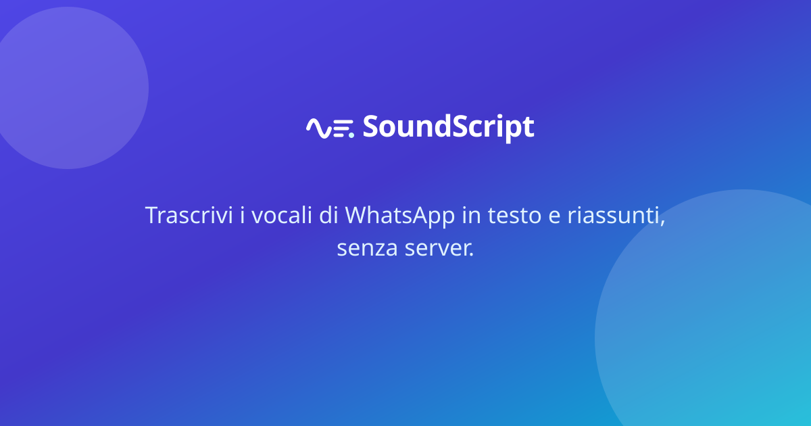

# 🎙️ SoundScript

**Turn voice notes into text and summaries — in your browser or as a native Android app.**
**Trasforma i vocali in testo e riassunti — nel browser o come app Android nativa.**

[**🇬🇧 English**](#english) · [**🇮🇹 Italiano**](#italiano)

[Live app](https://soundscript-app.pages.dev/) · [Landing page](https://soundscript-home.pages.dev/) · [Releases](../../releases) · [Download APK](https://github.com/elsewhere-s0ph/SoundScript/releases/latest/download/SoundScript.apk) · [Issues](../../issues)

    

---

## 🇬🇧 English

> [!TIP]
> **Try it now:** [soundscript-app.pages.dev](https://soundscript-app.pages.dev/) — no signup, no server, no data leaving your device except the API calls you configure yourself. Or install the [Android APK](https://github.com/elsewhere-s0ph/SoundScript/releases/latest/download/SoundScript.apk).

### What is SoundScript?

SoundScript is a **privacy-first Progressive Web App** that transcribes voice messages (e.g. from WhatsApp) and produces tailored TL;DR summaries. It runs on a **smart provider chain**: your API keys are tried in order with retries and model fallbacks, and if everything fails — or you're offline — **on-device models** (Whisper + Qwen via Transformers.js) take over.

The same codebase ships as **two channels**: the web/PWA (instant updates) and a **native Android APK** built with Capacitor (bundled web, native share receiver).

### Screenshots

| Desktop | Mobile |
|:---:|:---:|
|  |  |

### Features

- 🎙️ **Transcription chain** — OpenAI, Groq, Google Gemini, Mistral, custom OpenAI-compatible endpoints; Anthropic for summaries. Automatic retries, suggested-model fallback, per-key error memory.
- 🧠 **On-device fallback** — Whisper (tiny/base) + Qwen2.5 run locally via WebGPU/WASM; fully offline once downloaded.
- 📝 **Custom TL;DR** — length, style (narrative / bullets / actions & deadlines / formal / friendly), language, custom instructions, saved presets; auto-generated for audio over 60 s.
- ▶️ **Built-in audio player** — play/pause, ±10 s, draggable seek, playback speed 0.75×–2×.
- 🗂️ **History** — auto-saved (last 20), full-text & date search, per-entry delete, clear-all, JSON / Markdown / TXT export and JSON import with dedupe.
- 🛡️ **Settings backup** — export/import with two modes: safe (no API keys) and full (with keys, explicit warning).
- 📤 **Export** — TXT, Markdown, and PDF (via a branded print sheet).
- 📲 **Share target** — share audio straight from WhatsApp: on the **Android APK** via a native intent receiver, on the web PWA via the service worker; on iOS use the Files workaround (see in-app FAQ).
- 🤖 **Native Android APK** — Capacitor WebView with the web bundle inside; native `ACTION_SEND` audio receiver; installs over previous versions keeping data.
- 📱 **Full PWA** — installable with icons, screenshots and home-screen shortcuts, offline support, silent background updates.
- 🛟 **QoL** — draft recovery after accidental reloads, paste-audio-from-clipboard, cancel button, API-key tester, manual theme, end-of-processing vibration/notifications, status badges.
- ♿ **Accessible** — visible focus rings, screen-reader live announcements, AA contrast, reduced-motion support.

### How it works

1. **Input** — drop a file, pick one, paste from clipboard, or share from WhatsApp.
2. **Transcribe** — providers are tried in your chain order; local models close the chain.
3. **Summarize** — TL;DR generated with your rules (auto for audio > 60 s).
4. **Use** — listen with the player, edit, copy, export, or find it later in History.

### Supported providers

| Provider | Transcription | Summary | Notes |
|---|:---:|:---:|---|
| OpenAI | ✅ | ✅ | |
| Groq | ✅ | ✅ | fast free tier |
| Google Gemini | ✅ | ✅ | audio inline |
| Mistral | ✅ | ✅ | Voxtral STT |
| Anthropic | ❌ | ✅ | chat-only: transcription skips to next in chain |
| Custom endpoint | ✅ | ✅ | any OpenAI-compatible URL |
| **Local (offline)** | ✅ | ✅ | Whisper + Qwen, WebGPU/WASM |

### Privacy & data

- **No backend, no database, no analytics.** The app is a static site; this repository is public so anyone can verify there is no telemetry.
- API keys, settings and history live **only in your browser** (localStorage/sessionStorage).
- Audio files are kept **in memory for the current session only**; they are never stored in history.
- Exports and printing happen **entirely client-side**.
- The Android APK stores its data under its own WebView origin (`https://localhost`), separate from the web app's origin — the two channels do not share history or cached models.

### Two channels, one source

| | Web / PWA | Android APK (Capacitor) |
|---|---|---|
| Install | Chrome → "Install app" | download `SoundScript.apk` and install |
| Updates | instant, on every deploy | manual, install a newer APK |
| Share audio | service worker → cache | native intent → plugin → cache |
| Offline | service worker + local models | bundle inside APK + local models |
| Storage | origin `pages.dev` | origin `https://localhost` (separate) |

The channels do not interfere: native-only modules activate inside the APK, web-only modules in the browser.

### Hosting & distribution

| What | Where |
|---|---|
| Live app (only official host) | `https://soundscript-app.pages.dev` — Cloudflare Pages |
| Landing page | `https://soundscript-home.pages.dev` — Cloudflare Pages |
| Android APK | [GitHub Releases](../../releases) — `SoundScript.apk` (+ SHA-256 checksum) |
| Source of truth | this public GitHub repository |
| GitHub Pages | intentionally **disabled** |

Cloudflare builds the **web** from this repo on every push to `main`. **GitHub Actions** handles checks, the Android build, the tagged release (APK only) and social-image regeneration. Security headers (HSTS, X-Frame-Options, Permissions-Policy, cache rules) are served via `public/_headers`.

### Install as an app

- **Android (APK, recommended for sharing):** download [`SoundScript.apk`](https://github.com/elsewhere-s0ph/SoundScript/releases/latest/download/SoundScript.apk), open it, allow install from that source. Share a voice note from WhatsApp → transcription starts. Updates are manual (same package + signature, installs over the old one, keeps data).
- **Android / Desktop Chrome-Edge (PWA):** install prompt with screenshots; long-press the icon for shortcuts. Updates arrive automatically.
- **iOS / iPadOS:** Safari → Share → *Add to Home Screen*.

> [!NOTE]
> iOS does not allow web apps in WhatsApp's share sheet (system limitation). Workaround: in WhatsApp long-press the audio → Share → **Save to Files**, then open SoundScript → **Choose audio**.

### For developers

**Stack:** Vite · vanilla ES modules · [@huggingface/transformers](https://github.com/huggingface/transformers.js) · hand-rolled service worker · [Capacitor](https://capacitorjs.com) (Android).

    SoundScript/
    ├─ index.html                  # meta OG/Twitter, self-hosted font preload
    ├─ vite.config.js              # base "./", SW build stamp, app version
    ├─ capacitor.config.json       # appId, webDir dist, bundled Android
    ├─ package.json
    ├─ .github/workflows/          # checks, android-init, android-native, release, assets, cleanup
    ├─ scripts/                    # verify-apk, gen-android-icons, gen-og-image
    ├─ android/                    # native Capacitor project (generated by android-init)
    ├─ public/
    │  ├─ manifest.json            # icons, shortcuts, screenshots, share_target
    │  ├─ sw.js                    # offline cache, share-target POST handler
    │  ├─ share-target.html
    │  ├─ _headers                 # Cloudflare security & cache headers
    │  ├─ robots.txt, sitemap.xml
    │  ├─ icons/                   # pre-rasterized PNGs (192/512/maskable/apple/OG/shortcuts)
    │  ├─ fonts/roboto-flex.woff2  # self-hosted variable font
    │  ├─ screenshots/             # real store screenshots
    │  └─ *.svg                    # logos, icon sources, OG banner
    └─ src/
       ├─ main.js                  # UI, chain orchestration, player, history, exports
       ├─ providers.js             # API adapters (OpenAI/Groq/Google/Mistral/Anthropic)
       ├─ native-env.js            # APK: force standalone, set __SS_NATIVE__
       ├─ native-share.js          # APK: native intent → cache → ?shared=1
       ├─ install.js / install.css # install banner / Info row (native-aware)
       └─ style.css                # design system, themes, print sheet

    npm install
    npm run dev          # local dev server
    npm run build        # outputs dist/ (what Cloudflare publishes)
    npx cap sync android # copy dist/ into the native project

**Web deploy:** push to `main` → Cloudflare Pages (project `soundscript-app`) builds and publishes.

**Android / release (CI, not local):**

| Workflow | Trigger | What it does |
|---|---|---|
| `checks.yml` | push / PR | build + structural checks + Lighthouse |
| `android-init.yml` | manual | generates/updates `android/` (idempotent) |
| `android-native.yml` | push on relevant paths | signed APK + AAB as CI artifacts |
| `release.yml` | push tag `v*` | builds APK, gates it, attaches **APK + SHA256SUMS** to the Release |
| `assets.yml` | push on banner SVG | regenerates `public/icons/og-1200.png` |
| `cleanup.yml` | manual | removes obsolete TWA/Bubblewrap files |

The APK is a **Capacitor WebView with the bundle inside** (`assets/public`), not a Trusted Web Activity: a native plugin (`ShareReceiver`) reads the `ACTION_SEND` intent in-process, so sharing works without the Chrome TWA bridge. `versionName` comes from the tag, `versionCode` from the run number. Only the APK is attached to Releases (the AAB is Play-Store-only and stays out). See [`docs/CAPACITOR.md`](docs/CAPACITOR.md).

### Performance & quality highlights

- Core bundle light; the ML library is a **separate chunk loaded on demand**.
- Self-hosted variable font with `preload` + `font-display: optional` → **zero layout shift**.
- Service worker: network-first navigations, cache-first assets, silent self-update.
- Lighthouse-optimized: AA contrast, focus management, live regions, semantic markup.
- APK bundles the web assets, so first launch works offline; models download once into the APK's own storage.

### Troubleshooting

| Symptom | Cause / fix |
|---|---|
| `401/403` on a key | Key invalid or revoked — use the **Test** button before saving |
| `429` | Rate limit — the app retries once, then moves to the next provider |
| No WhatsApp share on iPhone | iOS limitation — use the Files workaround above |
| Local models slow first time | One-time download; use *Download local models now* on Wi-Fi |
| APK install blocked | Android setting — allow install from that source (browser/file manager) |
| APK not receiving audio | Install the latest APK over the old one (same signature); don't sideload a different build |
| APK shows old features | The APK is a snapshot — install a newer release; the web channel is always current |

### Credits & license

Built with [Transformers.js](https://huggingface.co/docs/transformers.js), [Capacitor](https://capacitorjs.com), [Roboto Flex](https://fonts.google.com/specimen/Roboto+Flex) and the public APIs of the providers listed above.
A [Little Elsewhere](https://littlelsewhere.pages.dev) project.
Personal project — all rights reserved unless a LICENSE file states otherwise.

---

## 🇮 Italiano

> [!TIP]
> **Provala subito:** [soundscript-app.pages.dev](https://soundscript-app.pages.dev/) — niente registrazione, niente server, niente dati che lasciano il dispositivo tranne le chiamate API che configuri tu. Oppure installa l'[APK Android](https://github.com/elsewhere-s0ph/SoundScript/releases/latest/download/SoundScript.apk).

### Cos'è SoundScript?

SoundScript è una **Progressive Web App privacy-first** che trascrive i messaggi vocali (es. da WhatsApp) e genera riassunti TL;DR su misura. Funziona con una **catena intelligente di provider**: le tue chiavi API vengono provate in ordine con retry e fallback di modello; se tutto fallisce — o sei offline — subentrano i **modelli on-device** (Whisper + Qwen via Transformers.js).

Lo stesso codice vive su **due canali**: web/PWA (aggiornamenti istantanei) e **APK Android nativo** costruito con Capacitor (web incluso, ricevitore di condivisione nativo).

### Catture schermo

| Desktop | Mobile |
|:---:|:---:|
|  |  |

### Funzionalità

- 🎙️ **Catena di trascrizione** — OpenAI, Groq, Google Gemini, Mistral, endpoint custom compatibili OpenAI; Anthropic per i riassunti. Retry automatici, fallback sul modello suggerito, memoria errori per chiave.
- 🧠 **Fallback on-device** — Whisper (tiny/base) + Qwen2.5 in locale via WebGPU/WASM; offline completo dopo il primo download.
- 📝 **TL;DR su misura** — lunghezza, stile (narrativo / elenco / azioni e scadenze / formale / amichevole), lingua, istruzioni custom, preset salvati; automatico sopra i 60 s.
- ▶️ **Player integrato** — play/pausa, ±10 s, seek trascinabile, velocità 0,75×–2×.
- 🗂️ **Cronologia** — salvataggio automatico (ultime 20), ricerca su testo e data, eliminazione singola, svuotamento, export JSON / Markdown / TXT e import JSON con deduplica.
- 🛡️ **Backup impostazioni** — export/import con due modalità: sicuro (senza chiavi API) e completo (con chiavi, avviso esplicito).
- 📤 **Export** — TXT, Markdown e PDF (foglio di stampa brandizzato).
- 📲 **Share target** — condividi l'audio da WhatsApp: sull'**APK Android** con un ricevitore intent nativo, sulla PWA web col service worker; su iOS c'è il percorso Files (vedi FAQ in app).
- 🤖 **APK Android nativo** — WebView Capacitor con il bundle web dentro; ricevitore audio `ACTION_SEND` nativo; si installa sopra le versioni precedenti mantenendo i dati.
- 📱 **PWA completa** — installabile con icone, screenshot e scorciatoie home, offline, aggiornamenti silenziosi.
- 🛟 **Qualità della vita** — recupero bozza dopo reload, incolla audio dagli appunti, pulsante Annulla, test chiave API, tema manuale, vibrazione/notifiche a fine elaborazione, badge di stato.
- ♿ **Accessibile** — focus ring visibili, annunci per screen reader, contrasto AA, rispetto di reduced-motion.

### Come funziona

1. **Ingresso** — trascina un file, sceglilo, incollalo dagli appunti o condividilo da WhatsApp.
2. **Trascrizione** — i provider vengono provati nell'ordine della tua catena; i modelli locali la chiudono.
3. **Riepilogo** — TL;DR generato con le tue regole (automatico sopra i 60 s).
4. **Uso** — riascolta col player, modifica, copia, esporta o ritrova tutto in Cronologia.

### Provider supportati

| Provider | Trascrizione | Riepilogo | Note |
|---|:---:|:---:|---|
| OpenAI | ✅ | ✅ | |
| Groq | ✅ | ✅ | piano gratuito veloce |
| Google Gemini | ✅ | ✅ | audio inline |
| Mistral | ✅ | ✅ | STT Voxtral |
| Anthropic | ❌ | ✅ | solo chat: la trascrizione passa al provider successivo |
| Endpoint custom | ✅ | ✅ | qualsiasi URL compatibile OpenAI |
| **Locale (offline)** | ✅ | ✅ | Whisper + Qwen, WebGPU/WASM |

### Privacy e dati

- **Nessun backend, nessun database, nessuna analytics.** L'app è un sito statico; questo repository è pubblico proprio perché chiunque possa verificare che non c'è telemetria.
- Chiavi API, impostazioni e cronologia vivono **solo nel tuo browser** (localStorage/sessionStorage).
- I file audio restano **in memoria per la sola sessione corrente**; non finiscono mai nella cronologia.
- Export e stampa avvengono **interamente lato client**.
- L'APK Android salva i dati sotto la propria origine WebView (`https://localhost`), separata da quella web: i due canali non condividono cronologia né modelli in cache.

### Due canali, un'unica sorgente

| | Web / PWA | APK Android (Capacitor) |
|---|---|---|
| Installazione | Chrome → «Installa app» | scarica `SoundScript.apk` e installa |
| Aggiornamenti | istantanei, a ogni deploy | manuali, installa una nuova APK |
| Condivisione audio | service worker → cache | intent nativo → plugin → cache |
| Offline | service worker + modelli locali | bundle dentro l'APK + modelli locali |
| Storage | origine `pages.dev` | origine `https://localhost` (separato) |

I canali non interferiscono: i moduli nativi si attivano dentro l'APK, quelli web-only nel browser.

### Hosting e distribuzione

| Cosa | Dove |
|---|---|
| App live (unico host ufficiale) | `https://soundscript-app.pages.dev` — Cloudflare Pages |
| Landing page | `https://soundscript-home.pages.dev` — Cloudflare Pages |
| APK Android | [GitHub Releases](../../releases) — `SoundScript.apk` (+ checksum SHA-256) |
| Sorgente di verità | questo repository GitHub pubblico |
| GitHub Pages | **disattivato** volontariamente |

Cloudflare compila il **web** da questo repo a ogni push su `main`. **GitHub Actions** gestisce checks, build Android, release taggata (solo APK) e rigenerazione dell'immagine social. Gli header di sicurezza (HSTS, X-Frame-Options, Permissions-Policy, regole cache) sono serviti tramite `public/_headers`.

### Installa come app

- **Android (APK, consigliato per condividere):** scarica [`SoundScript.apk`](https://github.com/elsewhere-s0ph/SoundScript/releases/latest/download/SoundScript.apk), aprilo, consenti l'installazione dall'origine. Condividi un vocale da WhatsApp → la trascrizione parte. Aggiornamenti manuali (stesso package + firma, si installa sopra, mantiene i dati).
- **Android / Desktop Chrome-Edge (PWA):** prompt di installazione con screenshot; pressione lunga sull'icona per le scorciatoie. Aggiornamenti automatici.
- **iOS / iPadOS:** Safari → Condividi → *Aggiungi a Home*.

> [!NOTE]
> iOS non consente alle web app di comparire nel menu Condividi di WhatsApp (limite di sistema). Alternativa: in WhatsApp tieni premuto l'audio → Condividi → **Salva su File**, poi apri SoundScript → **Scegli audio**.

### Per sviluppatori

**Stack:** Vite · vanilla ES modules · [@huggingface/transformers](https://github.com/huggingface/transformers.js) · service worker artigianale · [Capacitor](https://capacitorjs.com) (Android).

    SoundScript/
    ├─ index.html                  # meta OG/Twitter, preload font self-hosted
    ├─ vite.config.js              # base "./", timbro build SW, versione app
    ├─ capacitor.config.json       # appId, webDir dist, Android bundled
    ├─ package.json
    ├─ .github/workflows/          # checks, android-init, android-native, release, assets, cleanup
    ├─ scripts/                    # verify-apk, gen-android-icons, gen-og-image
    ├─ android/                    # progetto nativo Capacitor (generato da android-init)
    ├─ public/
    │  ├─ manifest.json            # icone, scorciatoie, screenshot, share_target
    │  ├─ sw.js                    # cache offline, gestore POST share-target
    │  ├─ share-target.html
    │  ├─ _headers                 # header Cloudflare di sicurezza e cache
    │  ├─ robots.txt, sitemap.xml
    │  ├─ icons/                   # PNG pre-rasterizzati (192/512/maskable/apple/OG/scorciatoie)
    │  ├─ fonts/roboto-flex.woff2  # font variabile self-hosted
    │  ├─ screenshots/             # screenshot reali
    │  └─ *.svg                    # loghi, sorgenti icone, banner OG
    └─ src/
       ├─ main.js                  # UI, orchestrazione catena, player, cronologia, export
       ├─ providers.js             # adapter API (OpenAI/Groq/Google/Mistral/Anthropic)
       ├─ native-env.js            # APK: forza standalone, imposta __SS_NATIVE__
       ├─ native-share.js          # APK: intent nativo → cache → ?shared=1
       ├─ install.js / install.css # banner install / riga Info (native-aware)
       └─ style.css                # design system, temi, foglio di stampa

    npm install
    npm run dev          # server di sviluppo locale
    npm run build        # genera dist/ (ciò che Cloudflare pubblica)
    npx cap sync android # copia dist/ nel progetto nativo

**Deploy web:** push su `main` → Cloudflare Pages (progetto `soundscript-app`) compila e pubblica.

**Android / release (CI, non locale):**

| Workflow | Trigger | Cosa fa |
|---|---|---|
| `checks.yml` | push / PR | build + controlli strutturali + Lighthouse |
| `android-init.yml` | manuale | genera/aggiorna `android/` (idempotente) |
| `android-native.yml` | push su path rilevanti | APK + AAB firmati come artifact CI |
| `release.yml` | push tag `v*` | build APK, gate, allega **APK + SHA256SUMS** alla Release |
| `assets.yml` | push sul banner SVG | rigenera `public/icons/og-1200.png` |
| `cleanup.yml` | manuale | rimuove i file TWA/Bubblewrap obsoleti |

L'APK è una **WebView Capacitor con il bundle dentro** (`assets/public`), non una Trusted Web Activity: un plugin nativo (`ShareReceiver`) legge l'intent `ACTION_SEND` in-process, quindi la condivisione funziona senza il ponte Chrome delle TWA. `versionName` dal tag, `versionCode` dal numero di run. Alle Release va solo l'APK (l'AAB serve solo al Play Store e resta fuori). Vedi [`docs/CAPACITOR.md`](docs/CAPACITOR.md).

### Punti di forza prestazionali

- Bundle core leggero: la libreria ML è un **chunk separato caricato on demand**.
- Font variabile self-hosted con `preload` + `font-display: optional` → **zero layout shift**.
- Service worker: navigazioni network-first, asset cache-first, auto-aggiornamento silenzioso.
- Ottimizzato Lighthouse: contrasto AA, gestione focus, live region, markup semantico.
- L'APK include gli asset web, quindi il primo avvio funziona offline; i modelli si scaricano una volta nello storage proprio dell'APK.

### Risoluzione problemi

| Sintomo | Causa / soluzione |
|---|---|
| `401/403` su una chiave | Chiave non valida o revocata — usa il pulsante **Testa** prima di salvare |
| `429` | Limite di frequenza — l'app riprova una volta, poi passa al provider successivo |
| Niente condivisione WhatsApp su iPhone | Limite iOS — usa il percorso Files qui sopra |
| Modelli locali lenti la prima volta | Download una tantum; usa *Scarica modelli locali ora* sotto Wi-Fi |
| Installazione APK bloccata | Impostazione Android — consenti l'installazione da quell'origine (browser/file manager) |
| L'APK non riceve l'audio | Installa l'APK più recente sopra il vecchio (stessa firma); non sideloadare build diverse |
| L'APK mostra funzioni vecchie | L'APK è uno snapshot — installa una release più recente; il canale web è sempre aggiornato |

### Crediti e licenza

Realizzato con [Transformers.js](https://huggingface.co/docs/transformers.js), [Capacitor](https://capacitorjs.com), [Roboto Flex](https://fonts.google.com/specimen/Roboto+Flex) e le API pubbliche dei provider elencati.
Un progetto [Little Elsewhere](https://littlelsewhere.pages.dev).
Progetto personale — tutti i diritti riservati, salvo diverso file LICENSE.

**[⬆ back to top / torna su](#soundscript)**

